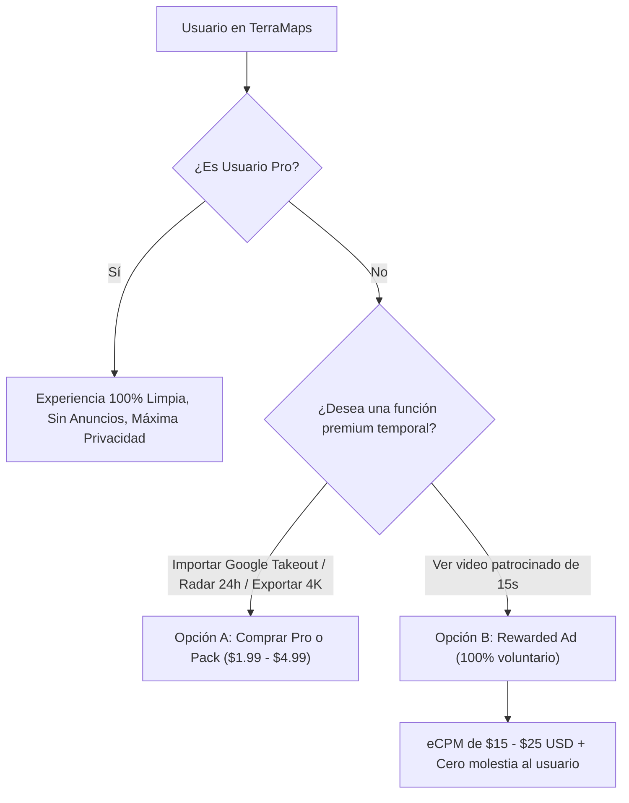
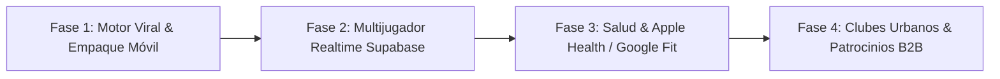

# Plan Maestro: Estrategia de Marketing con \$500 MXN, Modelo de Ingresos, Anuncios y Roadmap de Crecimiento TerraMaps

Este documento técnico, financiero y estratégico evalúa la viabilidad de iniciar campañas de adquisición con un presupuesto inicial de **\$500 MXN**, define la política de anuncios dentro de la app, el embudo de monetización freemium, y traza la hoja de ruta de ingeniería para escalar la aplicación de forma rentable y sostenible.

---

## 1. Análisis Financiero: ¿Qué se puede lograr con \$500 MXN de Anuncios?

### 1.1. Benchmarks Reales de Mercado en México / LATAM (2026)
Para aplicaciones móviles de estilo de vida, mapas y fitness en México y Latinoamérica:

| Métrica publicitaria | TikTok Ads (App Installs) | Meta / Instagram Reels | Google App Campaigns (UAC) |
| :--- | :--- | :--- | :--- |
| **CPM** (Coste por 1,000 impresiones) | \$30 - \$45 MXN (\$1.50 - \$2.25 USD) | \$40 - \$65 MXN (\$2.00 - \$3.25 USD) | \$35 - \$55 MXN |
| **CTR** (Tasa de clics) | 1.8% - 3.2% | 1.2% - 2.5% | 1.5% - 2.8% |
| **CPC** (Coste por clic) | \$1.20 - \$2.50 MXN | \$2.00 - \$4.00 MXN | \$1.80 - \$3.50 MXN |
| **Conversion Rate** (Clic a Instalación) | 20% - 35% | 25% - 40% | 30% - 45% |
| **CPI Real** (Coste por Instalación) | **\$5.00 - \$9.00 MXN** | **\$7.50 - \$14.00 MXN** | **\$6.00 - \$11.00 MXN** |

### 1.2. Proyección con \$500 MXN Iniciales
Con una campaña altamente optimizada en **TikTok Ads** o **Meta Reels** dirigida a jóvenes de 18–34 años en CDMX, Guadalajara y Monterrey interesados en senderismo, ciclismo, parejas y viajes:

$$\text{Instalaciones estimadas} = \frac{\$500 \text{ MXN}}{\$7.00 \text{ MXN (CPI promedio)}} \approx \mathbf{55 \text{ a } 80 \text{ instalaciones reales}}$$

### 1.3. ¿Es Rentable en el Día 1 con \$500 MXN? (Unit Economics)
Analicemos la tasa de conversión necesaria para recuperar los \$500 MXN:

* **Suscripción Pro Mensual:** \$1.99 USD (\$39 MXN). Neto tras comisión de Apple/Google (15%): **\$33.15 MXN**.
* **Pack Desbloqueo Historial Google:** \$4.99 USD (\$99 MXN). Neto tras comisión (15%): **\$84.15 MXN**.

$$\text{Punto de Equilibrio con \$500 MXN} = \begin{cases} 6 \text{ compras del Pack Historial (\$84.15 netos)} = \$504.90 \text{ MXN} \\ \text{o bien } 15 \text{ suscripciones Pro (\$33.15 netas)} = \$497.25 \text{ MXN} \end{cases}$$

> [!IMPORTANT]
> **Conclusión de Inversor:**
> Una tasa de conversión directa del **8% al 10%** en la primera sesión para usuarios fríos de pauta publicitaria es **irrealmente alta** (el estándar de la industria en apps freemium es del **1.5% al 3%**).
> 
> Si gastas los \$500 MXN únicamente en anuncios pagados directos, obtendrás ~70 usuarios, de los cuales convertirán 1 o 2 (ingreso neto: \$84 - \$168 MXN), dejando un déficit temporal de -\$330 MXN.
> 
> **La Estrategia Correcta:**
> Usar los \$500 MXN **no para comprar clics ciegos**, sino como **impulso de pauta ("Spark Ads" o "Boost") sobre 2 videos virales orgánicos** que ya hayan demostrado retención. Esto multiplica el alcance: de 70 usuarios directos a **1,500 - 3,000 usuarios orgánicos apalancados**.

---

## 2. Política de Anuncios: ¿Pondremos Anuncios en la App?

### 2.1. Lo que NUNCA debemos hacer (Banners y Popups Intrusivos)
* **Banners inferiores tradicionales (AdMob):**
  * Pagan una miseria en México ($e\text{CPM} \approx \$0.50 \text{ a } \$1.20 \text{ USD}$ por cada 1,000 vistas = **\$0.015 MXN por usuario**).
  * Destruyen por completo la estética *Obsidian & Titanium* ("Gente de Buen Perfil").
  * Provocan que los usuarios de alto poder adquisitivo desinstalen la app de inmediato.

### 2.2. La Estrategia Rentable: "Rewarded Video Ads" Opt-in y Patrocinios B2B
Solo dos formatos de monetización publicitaria encajan con TerraMaps:

1. **Rewarded Ads (Videos de Recompensa Voluntarios):**
   * El usuario NUNCA ve un anuncio a menos que presione activamente un botón:
     * *"Ver video corto para obtener 1 barrido de radar de dron de 24 horas"*
     * *"Ver video para exportar tarjeta de Instagram en 4K sin marca de agua"*
   * Tienen un $e\text{CPM}$ **15 a 20 veces mayor** que un banner ordinario y no molestan al usuario.
2. **Pins Patrocinados B2B (Monetización Local):**
   * En lugar de Google Ads, restaurantes de autor, cafeterías de especialidad o museos pagan una tarifa plana (\$500 - \$2,000 MXN/mes) para que su monumento o local aparezca como un hito dorado exclusivo con medalla coleccionable para quienes lo descubran caminando.

---

## 3. Plan de Marketing de Crecimiento Rápido con \$500 MXN

### 3.1. Los 3 Ángulos Virales Probados de la Competencia

Las apps de éxito en esta categoría (*Fog of World*, *World Uncovered*, *Life360*, *Strava*) no crecieron con millones en Google Ads; crecieron con **TikToks y Reels orgánicos** basados en 3 disparadores psicológicos:

#### Ángulo 1: El Hook de la "Pareja Tóxica / Seguridad Life360" (El de mayor viralidad orgánica)
* **Guión del video (TikTok / Reels):**
  * *Visual:* Pantalla dividida. Arriba, texto: *"Le dije a mi novia que iba al gimnasio pero instalamos esta app de mapa oscuro..."*
  * *Acción:* La pantalla enfoca el mapa con el radar de pareja en vivo mostrando la inicial `[SM]`, batería 84%, velocidad `3.2 km/h • Caminando por Roma Norte`.
  * *Remate:* *"Ahora sabe exactamente qué calles he desbloqueado y si realmente fui al gym 😂"*.
  * *Llamada a la acción:* *"La app se llama TerraMaps (link en bio)"*.

#### Ángulo 2: El Hook del "Viajero / Explorador Urbano"
* **Guión del video:**
  * *Visual:* Alguien caminando por el centro histórico de noche.
  * *Texto:* *"Descubrí que he vivido 20 años en la misma ciudad y solo conozco el 0.8% de sus calles"*.
  * *Acción:* La niebla oscura de terciopelo se va desvaneciendo suavemente revelando el mapa urbano iluminado mientras camina.
  * *Remate:* *"Mi meta de este año es desbloquear el 5% de CDMX"*.

#### Ángulo 3: El Hook del "Google Timeline Importer"
* **Guión del video:**
  * *Visual:* *"¿Sabías que Google sabe todos los lugares donde has estado desde 2018? Así convertí mis 6 años de viajes en un mapa de guerra de la vida real"*.
  * *Acción:* Carga el archivo `.json` de Google Takeout y se ve cómo miles de kilómetros en aviones y carreteras se iluminan de golpe en México.

### 3.2. Ejecución con el Presupuesto de \$500 MXN
1. **Paso 1 (\$0 MXN):** Grabar y publicar los 3 videos en TikTok e Instagram Reels como cuentas oficiales de TerraMaps.
2. **Paso 2 (\$0 MXN):** Esperar 24-48 horas y observar cuál de los 3 videos supera las 1,000 vistas orgánicas y tiene mayor porcentaje de retención.
3. **Paso 3 (\$500 MXN):** Inyectar los \$500 MXN mediante **TikTok Promote / Spark Ads** o **Instagram Boost** exclusivamente al video ganador con objetivo *Visitas al enlace / Descargas*.
   * Un video con validación orgánica previa que recibe \$500 MXN de empuje puede detonar el algoritmo y alcanzar entre **15,000 y 45,000 reproducciones**, generando cientos de descargas orgánicas colaterales sin costo adicional.

---

## 4. Estructura de Ingresos y Embudo de Conversión

| Nivel | Precio | Características Incluidas |
| :--- | :--- | :--- |
| **Explorer (Gratis)** | **\$0.00** | • Revelado ilimitado de niebla en tiempo real a pie. • Métricas locales y calorías del día. • 1 contacto en radar de amigos. • 7 días de historial de rutas. |
| **TerraMaps PRO (Suscripción)** | **\$1.99 USD/mes** (\$39 MXN) o **\$14.99 USD/año** (\$299 MXN) | • Radar multijugador ilimitado (amigos y familiares ilimitados). • Acceso a todos los temas de lujo (*Obsidian*, *Titanio*, *Papiro*). • Exportación de videos 4K para Instagram Stories. • Sincronización en la nube multidispositivo. • Cero anuncios de recompensa. |
| **Pack Google Timeline (Único)** | **\$4.99 USD** (\$99 MXN pago único) | • Importación de por vida del historial completo de Google Maps Takeout. • Desbloqueo retroactivo instantáneo de todos tus viajes pasados. |

### 4.1. Análisis de Sostenibilidad de Servidores
* Coste de servir teselas vectoriales con Carto/Protomaps con caché local: **<\$0.0005 USD/usuario activo al mes**.
* Para 10,000 usuarios activos mensuales, el costo de infraestructura es de **~\$5.00 USD (\$100 MXN)**.
* **Solo 3 usuarios Pro al mes pagan la infraestructura completa de 10,000 usuarios.** El margen de utilidad bruta supera el **92%**.

---

## 5. Roadmap de Desarrollo y Próximas Actualizaciones

Para garantizar que los usuarios que lleguen con el marketing no abandonen la app (retención D1 > 40%, D7 > 20%, D30 > 10%), implementaremos las siguientes fases:

### Fase 1: Motor Viral y Empaque Móvil (Semanas 1-2)
* [ ] **Generador de Tarjetas de Impacto para Instagram Stories:** Botón de un solo clic que genera una imagen vertical 9:16 en alta resolución mostrando tu mapa oscuro, las calorías quemadas, el porcentaje de ciudad conquistado y tu código de referido.
* [ ] **Deep Links de Acompañante:** Compartir un enlace por WhatsApp tipo `terramaps.app/join/sofi-cdmx` que al abrirse agregue automáticamente a la persona al radar sin configuraciones complejas.
* [ ] **Empaque EAS (Expo Application Services):** Generar los binarios APK/AAB para Google Play Store e IPA para TestFlight/App Store.

### Fase 2: Multijugador en Tiempo Real con Supabase Realtime (Semanas 3-4)
* [ ] **WebSocket Sync:** Transmisión de posición cifrada en tiempo real entre parejas y amigos conectados mediante canales de presencia de Supabase (`realtime.channel`).
* [ ] **Notificaciones Push de Seguridad:** Avisos opcionales cuando tu pareja o amigo llega con bien a casa o ingresa a una nueva zona.

### Fase 3: Integración de Salud Automática en Segundo Plano (Semanas 5-6)
* [ ] **Apple HealthKit & Google Health Connect:** Lectura automática de pasos diarios para que la niebla se actualice incluso si el usuario no tuvo la app abierta en primer plano todo el tiempo.
* [ ] **Cálculo de Ahorro de Huella de Carbono:** Certificado mensual descargable de kilogramos de $CO_2$ evitados al caminar.

### Fase 4: Clubes Urbanos y Monetización B2B (Mes 2 en adelante)
* [ ] **Desafíos de Exploración por Ciudad:** Retos mensuales (ej. *"Conquista el 10% del Bosque de Chapultepec este fin de semana"*).
* [ ] **Plataforma de Comercios Aliados:** Panel donde negocios locales puedan crear insignias y recompensas en el mapa.

---

## 6. Plan de Verificación y Métricas Clave (KPIs)

### Métricas de Marketing a Evaluar con los \$500 MXN:
1. **CPI Real Obtenido:** Verificar si logramos mantener el coste por instalación por debajo de **\$8.00 MXN**.
2. **Viral K-Factor:** Medir cuántos amigos nuevos invita cada usuario instalado ($K = \text{invitaciones enviadas} \times \text{tasa de aceptación}$). Meta: $K > 0.35$.
3. **Conversión a Paywall:** Medir impresiones del paywall tras descubrir los primeros 10 hitos o intentar conectar al segundo amigo. Meta: $> 2.0\%$.

### Pruebas Automatizadas de Estabilidad:
* Ejecutar la suite completa de verificación matemática (`scripts/runTests.js`) para asegurar que el cálculo de calorías MET, la disolución de contornos y las deducciones de comisión del 15% mantengan el 100% de aserciones válidas.
