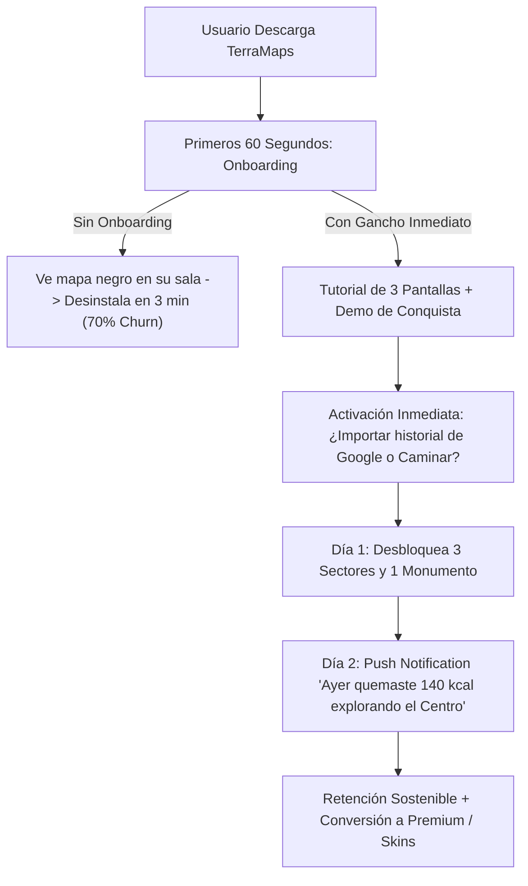

# Plan Maestro v7: Auditoría de Lanzamiento y Preparación para el Mercado Masivo

## 1. Diagnóstico Honesto: ¿Podemos Publicar y Gustarle a la Mayoría de Usuarios Hoy?

### La Respuesta Directa
**No todavía para publicación masiva en tiendas (App Store / Google Play), pero estamos al 80% del camino y en un estado excelente para pruebas privadas (TestFlight / APK cerrado).**

Si publicáramos en este instante en la App Store y lanzáramos los \$500 MXN en anuncios:
1. **La interfaz y el motor técnico ya son superiores a la competencia:** La niebla orgánica suave (sin hexágonos), la diferenciación de vuelos en avión, el consumo de batería ultrabajo y las skins ejecutivas superan a *Fog of World* (que cuesta \$600 MXN de entrada) y a *Strut*.
2. **Sin embargo, sufriríamos una tasa de abandono del 70% en los primeros 3 minutos:** Un usuario común que descarga la app desde un anuncio de Instagram la abre desde su sala o recámara, ve el 99.9% de la pantalla en negro, camina 5 metros dentro de su casa, no ve ningún cambio drástico y la desinstala creyendo que "no funciona".
3. **Apple y Google rechazarían la versión de producción:** Ambas tiendas exigen por reglamento estricto 3 elementos obligatorios antes de aprobar cualquier app con inicio de sesión:
   - Botón visible de *"Eliminar mi cuenta y borrar todos mis datos"* (Directiva obligatoria de Apple desde junio de 2022).
   - Enlace activo a Política de Privacidad y Términos de Servicio.
   - Justificación en video del permiso de ubicación *"Permitir siempre"* en segundo plano.

---

## 2. Las 5 Brechas Críticas que Debemos Cerrar para Enamorar al Usuario Común



---

### Brecha 1: El Embudo de los Primeros 60 Segundos (Onboarding de Alta Retención)
* **El Problema:** El usuario nuevo no sabe qué hacer al abrir la app por primera vez.
* **La Solución:** Un flujo de bienvenida de 3 pantallas en titanio y cristal obsidiana:
  1. **Pantalla 1 - La Premisa:** *"El mundo está cubierto por un velo. Tu vida diaria es la expedición para revelarlo."*
  2. **Pantalla 2 - El Gancho de Retención:** *"¿Has viajado en los últimos 5 años? Puedes iluminar de golpe todos tus vuelos y carreteras con tu historial de Google."*
  3. **Pantalla 3 - El Permiso:** *"Permite la ubicación en segundo plano para registrar tus caminatas con la pantalla apagada y consumo de batería cercano al 1%."*
  - **Bono de Bienvenida:** Desbloquear de cortesía el vecindario inmediato del usuario (un radio de 150m) para que su mapa empiece vivo desde el segundo 1.

---

### Brecha 2: Requisitos Obligatorios de Apple App Store y Google Play
Para evitar rechazos en el proceso de revisión de Apple:
1. **Botón de Borrado de Cuenta:** Agregar en `ProfileModal` el botón *"Eliminar Cuenta y Datos"*, con diálogo de confirmación que limpie el almacenamiento local y el registro en Supabase.
2. **Política de Privacidad y Términos:** Publicar un enlace HTML simple y limpio (`/privacy` y `/terms`) que declare expresamente que **TerraMaps nunca vende ni comercializa las coordenadas GPS del usuario a terceros**.
3. **Modal de Consentimiento de Permisos GPS:** Explicar al usuario *por qué* se solicita la ubicación en segundo plano antes de que el sistema operativo lance el diálogo nativo de iOS/Android.

---

### Brecha 3: Conexión de Pagos Reales (De Simulación a Dinero en tu Cuenta)
Actualmente, el sistema de cobro ($149 MXN por importar historial y compra de skins) funciona con un mock de validación.
* **Para recibir dinero real:** Necesitamos integrar **RevenueCat** (`react-native-purchases`).
* **Ventaja de RevenueCat:** Permite cobrar en pesos mexicanos (MXN) a través de Apple Pay y Google Play Billing con solo 15 líneas de código, manejando reembolsos, impuestos y transferencias directas a tu cuenta bancaria.

---

### Brecha 4: El Bucle de Retención del Día Siguiente (Notificaciones Locales)
Para que el usuario no olvide la app después del primer día:
* **Notificación de Racha:** *"Llevas 2 días consecutivos explorando. Da un paseo hoy para no perder tu racha."*
* **Notificación de Hito Territorial:** *"¡Has desbloqueado el Palacio de Bellas Artes y el 0.05% de la CDMX!"*
* Todo manejado localmente en el dispositivo sin costos de servidor.

---

### Brecha 5: Empaquetado Nativo para Descarga en Tiendas (EAS Build)
* Actualmente, la app funciona como PWA Web interactiva de alto rendimiento.
* Para publicarla en Google Play Store (formato `.aab`) y en App Store (formato `.ipa`), se compila mediante **Expo Application Services (EAS Build)**:
  - Genera el instalador oficial firmado para Android.
  - Genera la versión oficial para TestFlight en iOS.

---

## 3. Plan de Implementación Recomendado

```mermaid
graph LR
    subgraph Fase 1 ["Fase 1: Retención & Experiencia"]
        F1A["Onboarding de 3 Pasos"] --> F1B["Radio de Cortesía Inicial"]
        F1B --> F1C["Notificaciones Locales de Racha"]
    end
    subgraph Fase 2 ["Fase 2: Blindaje de Tiendas"]
        F2A["Botón Eliminar Cuenta"] --> F2B["Páginas Legales /privacy"]
        F2B --> F2C["Explicación de Permiso GPS"]
    end
    subgraph Fase 3 ["Fase 3: Lanzamiento & Cobros"]
        F3A["EAS Build (APK / TestFlight)"] --> F3B["RevenueCat (Pagos Reales)"]
        F3B --> F3C["Campaña Piloto $500 MXN"]
    end
    Fase 1 --> Fase 2 --> Fase 3
```

---

## 4. Plan de Acción Detallado

### Tarea 1: Onboarding de Bienvenida de Alto Nivel (`OnboardingModal.tsx`)
- Crear un componente modal que se muestre **únicamente en la primera apertura** de la app.
- 3 diapositivas limpias con tipografía sobria:
  - Concepto del velo de niebla.
  - Opción de importar historial previo o empezar desde cero caminando.
  - Solicitud amigable de permiso GPS.
- Al finalizar, desbloquea automáticamente el sector inicial del usuario para que el mapa no aparezca vacío.

### Tarea 2: Cumplimiento Regulatorio de Tiendas (`AccountDeletionModal.tsx` & `/privacy`)
- Agregar en el panel de Perfil el flujo de eliminación de cuenta.
- Crear los archivos estáticos de términos de servicio y privacidad en `web/privacy.html` y `web/terms.html`.

### Tarea 3: Bucle de Retención y Recompensas
- Programar notificaciones locales en el teléfono al cruzar cerca de un monumento o al finalizar un trayecto de más de 1 km.

### Tarea 4: Configuración de EAS Build para Generar el APK de Android
- Configurar `app.json` con los identificadores oficiales de paquete (`com.terramaps.app`).
- Generar el archivo de compilación para que puedas instalar la app directamente en tu celular Android sin necesidad de túneles ni navegadores.

---

## 5. Preguntas Clave para Decidir el Siguiente Paso

> [!IMPORTANT]
> 1. **¿Prefieres que primero implementemos el Onboarding de Bienvenida y el radio de cortesía inicial** para que la primera impresión de cualquier usuario nuevo sea espectacular y no vea la pantalla en negro?
> 2. **¿Tu celular principal es Android o iPhone?**
>    - Si es **Android**, podemos generar un archivo `.apk` instalable de inmediato para que lo tengas como app nativa instalada con icono en tu cajón de aplicaciones.
>    - Si es **iPhone**, el camino para instalarlo como app nativa fuera del navegador es vía Apple TestFlight (requiere cuenta Apple Developer).
